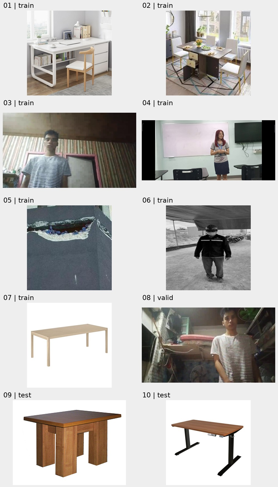

# عينات صور الخلفية

عشر صور من مجموعة البيانات ليس لها ملفات تسميات، لمراجعة استخدامها كخلفيات.

- [1: الصورة الأصلية](01.jpg) — `train/images/000001_jpg.rf.39nGVjqaPXCbgImGUYeQ.jpg`
- [2: الصورة الأصلية](02.jpg) — `train/images/60_jpg.rf.0WMIX2gHGVOBffHfb8Xz.jpg`
- [3: الصورة الأصلية](03.jpg) — `train/images/frame_0266_jpg.rf.BO2lqAXwbKwQbhcIfV72.jpg`
- [4: الصورة الأصلية](04.jpg) — `train/images/frame_0680_jpg.rf.dSoOsviP9g73GyOoGeNV.jpg`
- [5: الصورة الأصلية](05.jpg) — `train/images/image1632_jpg.rf.NqxnztkQnvXPyabzJMri.jpg`
- [6: الصورة الأصلية](06.jpg) — `train/images/standing_8_11_23-26-_jpg.rf.l6szbohzn5IYJcvDSB6D.jpg`
- [7: الصورة الأصلية](07.jpg) — `train/images/table34-2-_jpg.rf.s41kshQezhgKVzTXwC03.jpg`
- [8: الصورة الأصلية](08.jpg) — `valid/images/frame_0756_jpg.rf.hcY1SI9TZjxfdlKBkorJ.jpg`
- [9: الصورة الأصلية](09.png) — `test/images/000061_png.rf.o8cj3iTh46yDuXsxMNIz.png`
- [10: الصورة الأصلية](10.jpg) — `test/images/table80_jpg.rf.Maa5ZuZCG6hRbOx88hrQ.jpg`
