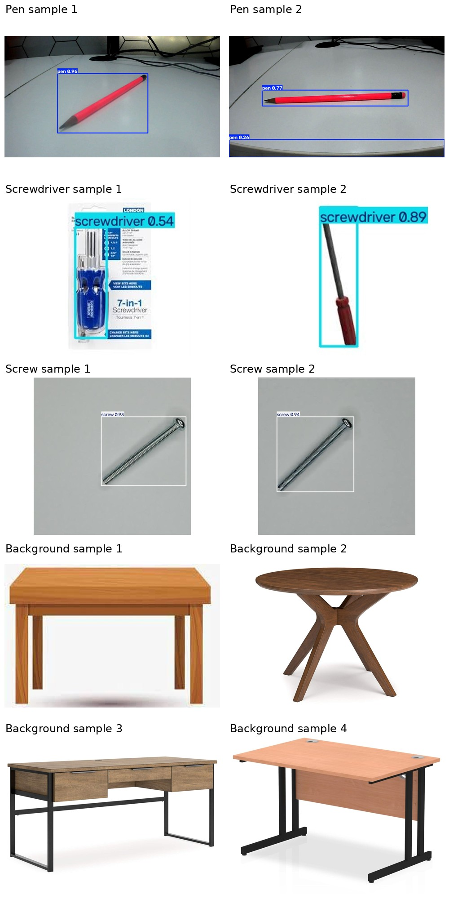

# YOLO model test results

Model weights: [`models/best.pt`](../../models/best.pt). Ten annotated examples below include labeled objects and confirmed background photos. The full evaluation used 920 test images.

Metrics and per-class results are in [`metrics.json`](metrics.json). Background false detections were measured at confidence 0.25.
